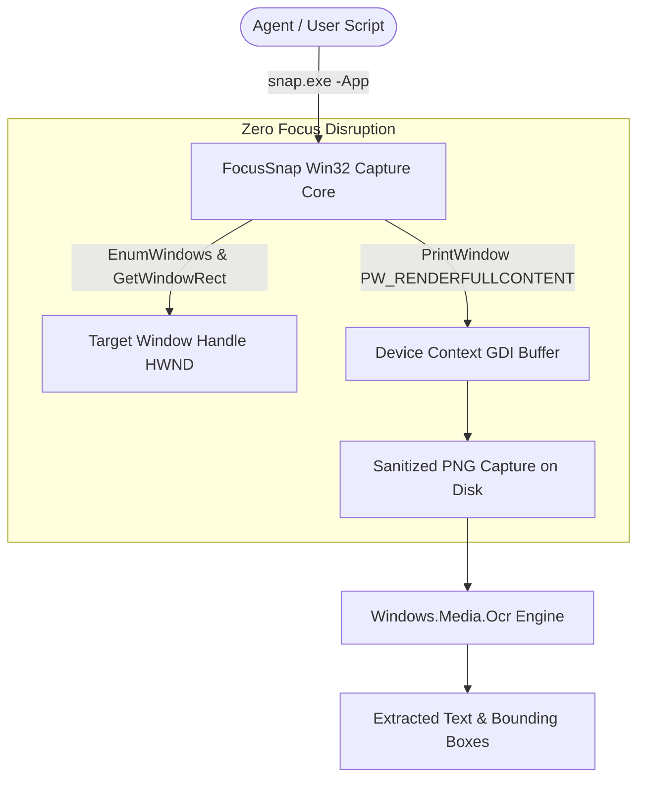

<p align="center"><a href="https://kitsunetechnologies.org/work"></a></p>

# FocusSnap (snap)

> Fast, non-intrusive Windows screen and window capture utility. Captures background windows without stealing user keyboard/mouse focus, with native Windows OCR text extraction.

<p align="center">
  <a href="https://github.com/KitsuneTech1/snap/releases"></a>
  <a href="https://github.com/KitsuneTech1/snap/actions/workflows/ci.yml"></a>
  <a href="LICENSE"></a>
  <a href="https://microsoft.com/windows"></a>
  <a href="snapsrc/Program.cs"></a>
  <a href="ocr.ps1"></a>
</p>

<p align="center">
  <a href="https://github.com/KitsuneTech1/snap/releases/latest"><strong>📦 Download Precompiled snap.exe (Standalone ZIP)</strong></a> •
  <a href="#-quick-start-noob-friendly"><strong>⚡ Quick Start Guide</strong></a> •
  <a href="#architecture--capture-pipeline"><strong>🖥️ Architecture</strong></a>
</p>

---

FocusSnap is built specifically for autonomous agents, background monitoring tools, accessibility helpers, and testing harnesses that need to record windows without interrupting the user's active keyboard context or activating windows.

---

## Architecture & Capture Pipeline



---

## Features

- **Never Steals Focus**: Uses native GDI `PrintWindow` with `PW_RENDERFULLCONTENT` to capture windows without bringing them to the foreground or stealing focus from what you're working on.
- **Precompiled Single Binary**: Includes standalone `snap.exe` (only 14 KB!) with zero installation or runtime setup required.
- **Built-in Windows OCR**: Uses the native `Windows.Media.Ocr` engine built into Windows 10/11. No Tesseract, cloud APIs, or external language models needed.
- **Region & Window Filtering**: Capture by window title regex, executable name, bounding box coordinates, or active monitor.
- **Image Cropper & Annotator (`snapedit.py`)**: Scriptable image manipulation tool for cropping, highlighting, and formatting screenshots.

---

## 🚀 Quick Start (Noob-Friendly)

### 1. Download & Launch
1. Download the [**Precompiled FocusSnap ZIP**](https://github.com/KitsuneTech1/snap/releases/latest) and unzip it.
2. Double-click **`start.bat`** to see all available command-line flags.

### 2. Common Capture Commands
Open PowerShell or Command Prompt in the folder:

```cmd
:: 1. List all visible windows and titles
snap.exe -List

:: 2. Capture a window by application name (e.g. Chrome, Notepad)
snap.exe -App notepad -Out notepad.png

:: 3. Capture full screen
snap.exe -Out screen.png

:: 4. Capture a specific screen region
snap.exe -Region "0,0,1280,720" -Out region.png

:: 5. Extract text via native OCR
powershell -ExecutionPolicy Bypass -File ocr.ps1 -ImagePath screen.png
```

---

## 🛠️ Compiling from Source

If you want to recompile the native executable from the C# source:

```powershell
powershell -NoProfile -ExecutionPolicy Bypass -File .\build.ps1
```

The build script uses the built-in Microsoft .NET Framework C# compiler (`csc.exe`). No Visual Studio installation required.

---

## 🧪 Testing

Run the included pytest suite for the screenshot manipulation suite:

```bash
python -m pytest tests
```

Tests verify:
- Pixel bounding-box math and coordinate normalization.
- Metadata attachment and DPI awareness.
- Region cropping safety and boundary checks.

---

## License

MIT. Copyright (c) 2026 Kitsune Technologies LLC. Full text in [LICENSE](LICENSE).

<p align="center"><sub>Part of <b>Buildtober 2026</b>: 31 open source projects in 31 days. Built by <a href="https://kitsunetechnologies.org/work">Kitsune Technologies</a>. More at <a href="https://github.com/KitsuneTech1">github.com/KitsuneTech1</a>.</sub></p>
